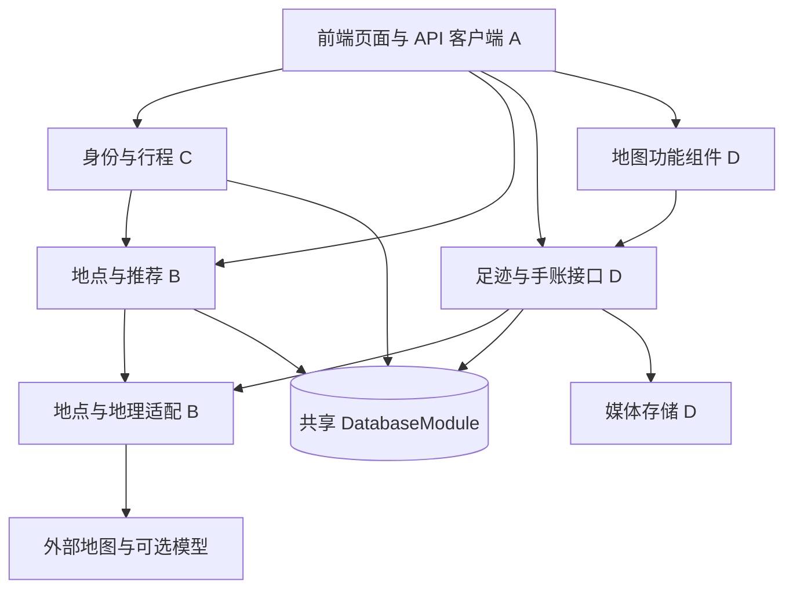
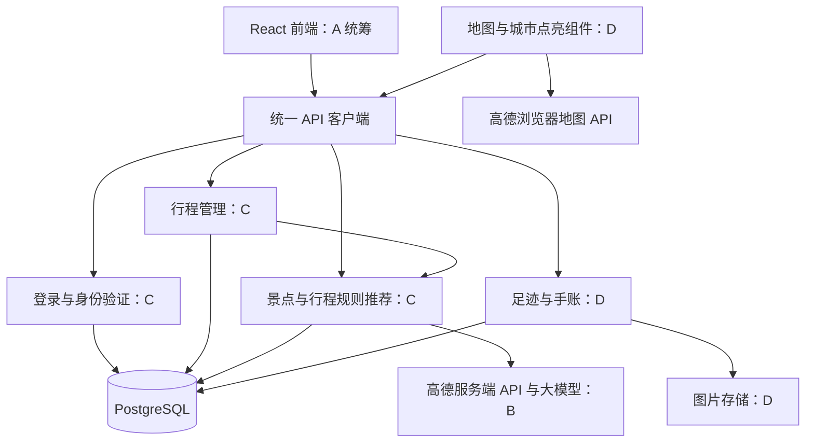
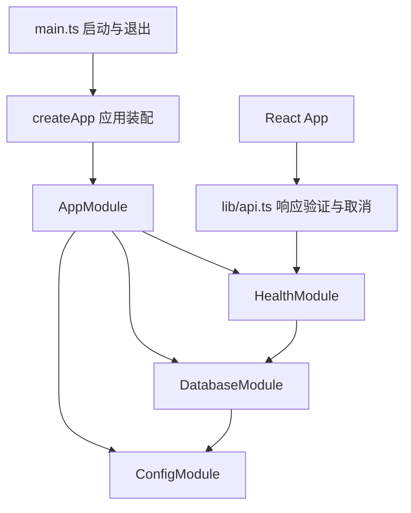
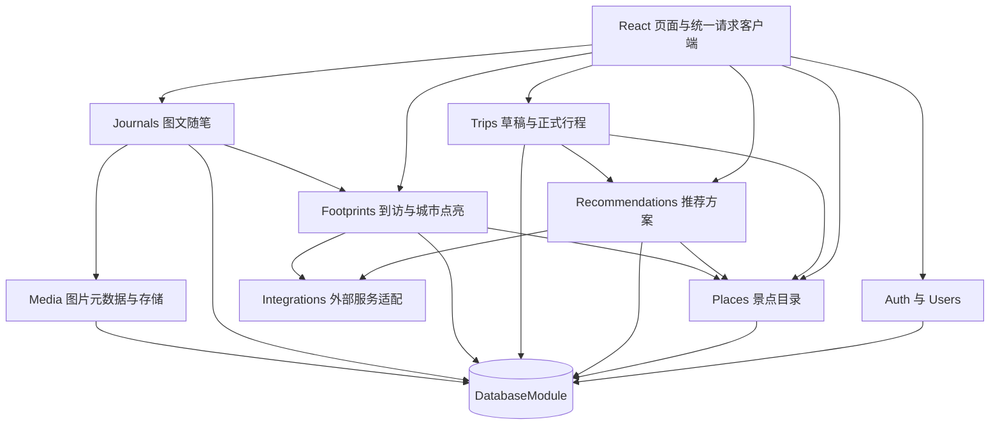

# 架构与重构说明

> 合并自：总体架构.md、项目架构与四人分工.md、现有代码问题分析与重构架构.md、架构验证记录.md（2026-11-26）。各部分保留原文与历史标注，未按当前实现改写。

## 一、四人并行开发总览（原 总体架构.md）

> 当前开发分工已于 2026-11-02 调整，创建行程全流程与规则推荐归 C，A 负责正式外层集成，B 协作景点数据和地图凭据，D 负责足迹手账。已实现模块、可调用接口和待外部条件详见 [当前分工与联调交付](../当前分工与联调交付.md)。下面的“已有与待实现”和示意图记录原始开发起点，不作为当前完成状态。

本文件是四人开始开发的共同入口。沿用现有 React + Vite、NestJS、PostgreSQL 和 npm workspaces，在一个仓库内按模块开发。四份个人说明拆分工作和测试依赖，不另建四套系统。

## 1. 先分清已有与待实现

| 状态           | 内容                                                                                                     |
| -------------- | -------------------------------------------------------------------------------------------------------- |
| 已有代码       | 公共配置与数据库、健康检查、前端状态页；B 的地点目录、规则排程、方案存储、地图及可选模型适配             |
| 已有接口       | 两个健康检查及 B 的六个业务接口；业务认证需 C 接入，默认拒绝未认证请求                                   |
| 已有数据库迁移 | users、trips、trip_members；B 的 destinations、places、destination_admin_codes、recommendation_proposals |
| 当前验证       | B 的快速与真实 PostgreSQL 测试，详见 [B 验证记录](../records/验证记录-B.md)                              |
| 待实现         | 登录、正式行程、足迹、图文手账、上传和前端业务页面；真实外部 Key 调用及联合验收                          |

本文及配套文件不是业务接口已经可调用的证明。示例 JSON 是测试输入和预期输出，不是运行中的模拟服务器，也不会自动写入数据库。

接口路径、字段、负责人和实现状态统一维护在 [接口与数据约定](../接口与数据约定.md)。B 的演示目录可通过 `npm run db:seed:b` 显式导入，测试身份只存在于测试装配。

原代码的问题和已完成重构见 [现有代码问题分析与重构架构](架构与重构.md)，历史验证结果见 [架构验证记录](架构与重构.md)。

## 2. 开发文档入口

| 文档                                                                    | 谁先读 | 用途                                         |
| ----------------------------------------------------------------------- | ------ | -------------------------------------------- |
| [接口与数据约定](../接口与数据约定.md)                                  | 全员   | 字段、接口、错误、版本、日期和坐标的共同约定 |
| [A：前端开发说明](../development/A-前端开发说明.md)                     | A      | 页面、接口客户端、模拟数据和交互验收         |
| [B：API 与智能推荐开发说明](../development/B-API与智能推荐开发说明.md)  | B      | 地点目录、外部适配、推荐算法和方案预览       |
| [C：行程业务开发说明](../development/C-行程业务开发说明.md)             | C      | 身份、草稿、确认保存、编辑和数据库协调       |
| [D：足迹与地图手账开发说明](../development/D-足迹与地图手账开发说明.md) | D      | 地图组件、真实到访、随笔、媒体与城市聚合     |
| [联调与验收说明](../联调与验收说明.md)                                  | 全员   | 启动条件、模拟与真实测试、接口交接和验收场景 |
| [统一示例](../examples/README.md)                                       | 全员   | 相同用户、城市、地点和正常/异常数据          |

## 3. 模块调用方向



推荐模块不依赖行程模块。C 维护推荐方案及只读查询，并在行程模块确认保存。D 通过地点接口使用目录，不直接查询其内部表。所有持久化模块复用现有数据库模块。

## 4. 代码与协作边界

| 成员 | 主要目录，业务目录待创建                                                                                         | 不能重复负责的内容                     |
| ---- | ---------------------------------------------------------------------------------------------------------------- | -------------------------------------- |
| A    | `apps/web/src/components`、`features/auth`、`features/trip-wizard`、`features/trips`、`features/journals`、`lib` | 不编写后端排程或另存一套正式行程       |
| B    | 与 C 协作 `places` 数据核实及外部地图适配                                                                        | 不重复实现 C 的推荐或维护用户到访记录  |
| C    | `features/trip-create`、`auth/users/trips/recommendations`、共享引擎、目录初版和数据库协调                       | 不开发 D 的足迹手账；外层路由与 A 协调 |
| D    | `apps/api/src/footprints`、`journals`、`media`；`apps/web/src/features/footprints`                               | 不以计划或行程状态自动创建真实到访     |

A 负责手账表单、列表和详情页面；D 负责这些页面的数据接口与可嵌入地图组件。D 自测时可做仅供开发的地图宿主页，主应用页面和导航仍由 A 维护。

公共文件协调：

- C 负责合并 `apps/api/src/app.module.ts`、公共配置、身份 Guard、数据库迁移及根级工程配置的改动。
- A 负责合并 `apps/web/src/App.tsx`、公共样式、页面路由和基础请求客户端的改动。
- 各负责人维护自己的共享类型文件；`packages/shared/src/index.ts` 由 C 汇总导出，A 复核前端使用。
- `packages/shared` 当前仅用于类型。不得直接把运行时模拟数据、枚举对象或工具函数放入该包后供后端执行；如有需求，先补构建与导出配置。
- 接口变化先改 [接口与数据约定](../接口与数据约定.md) 和相关示例，再同步调用方。文档契约优先于旧文档中的概括性接口建议。

## 5. 每个人独立测试的最小闭环

| 成员 | 不等待他人时可完成的闭环                                 | 必须另外完成的真实集成验证                         |
| ---- | -------------------------------------------------------- | -------------------------------------------------- |
| A    | 假客户端返回统一数据，完成四步表单、预览、编辑和错误显示 | 接真实 API 验证登录、保存和刷新恢复                |
| B    | 内存景点、假路线/模型适配器、固定时钟，生成确定性的推荐  | 真实数据库方案保存；配置密钥后的外部服务测试       |
| C    | 假当前用户、假推荐查询和测试数据库，验证行程事务         | 接真实登录 Guard 与 B 的方案仓库，验证权限和并发   |
| D    | 假地点解析、测试存储、测试数据库，地图用固定数据         | 接真实身份、B 的城市解析和浏览器地图，验证图文闭环 |

替换依赖只能放在测试或显式开发入口。公共应用不能通过前端传入的用户 ID、任意请求头或固定全局用户绕过身份验证。依赖未完成时，测试使用替身并如实记录，不能把结果标为整套系统通过。

## 6. 第一轮交付顺序

1. 全员先读接口契约及示例，明确 A/C、B/C、A/D 三处交接。
2. A 做使用假客户端的表单；B 做内存景点与规则推荐；C 做身份与草稿；D 做固定数据地图和到访数据模型。可以同步开始。
3. B、C 先接通景点目录、推荐预览和确认保存；A 再接这条完整流程。
4. D 接入共同身份与地点标识，A 接入手账界面，完成第二条流程。
5. 验证真实数据库、跨用户隔离、并发冲突、图片文件恢复和外部依赖失败。此后再增加可选智能增强功能。

采用同一个仓库的个人分支或各自本地副本。当前目录未发现 Git 仓库元数据，分支流程需要团队先建立共同仓库后使用；不要直接在同一个共享目录中同时编辑文件。首次导入只提交源码和锁文件，不提交 `node_modules`、`.env`、私人照片和构建产物。

## 二、旅行规划与地图手账项目架构（原 项目架构与四人分工.md）

> 2026-11-02 分工更新：按 C 在本次开发中的要求，创建行程前端全流程与景点/行程推荐已调整由 C 负责。此更新记录当前开发归属，尚不代表其他成员已完成评审或合并。当前实现与交付入口见 [当前分工与联调交付](../当前分工与联调交付.md)。下文未更新的目录示意属于原始设计。

现有代码的具体问题、已落地的基础重构和分阶段迁移以 [现有代码问题分析与重构架构](架构与重构.md) 为主。本文作为业务模块与四人职责的详细补充。

四人小范围独立开发时，使用 [并行开发总览](架构与重构.md) 中的个人说明、[接口与数据约定](../接口与数据约定.md) 及共同示例。接口的具体字段与行为以该契约为准，本文保留总体业务说明。

本方案在现有 React、TypeScript、Vite、NestJS 和 PostgreSQL 项目上展开，面向四人课程团队。产品包含两条主流程：旅行前选择目的地、日期、偏好和景点，生成并保存可修改的行程；旅行后在地图上标记真实到访的地点，添加图片和随笔，积累个人旅行手账。

本文规定后续开发的模块、负责人和接口。当前仓库已有前后端骨架、模块化配置与数据库服务、健康检查、运行测试及三张初始数据库表；下文新增的业务目录、表和接口属于待开发设计，不表示已经实现。

## 1. 产品范围

客户端采用适配手机和电脑浏览器的响应式 Web 应用，沿用现有技术栈。首页可继续使用此前的省份地图卡片风格，日期、偏好和景点选择参考提供的三张截图。

第一版实现以下功能：

1. 账号注册、登录，查看自己的行程和手账。
2. 选择城市、出发和返回日期，设置主题偏好、出行节奏和交通方式。
3. 搜索景点、查看推荐依据，添加和移除已选景点。
4. 生成每日行程预览，确认后保存；支持手动增删、换日和排序。
5. 标记实际到访地点和日期，在地图上显示地点，并点亮对应城市。
6. 为到访地点撰写随笔、上传图片，并按地点或时间回看。

首期准备一个示范省份及其中一至两个城市的景点数据。省份卡片可以用于展示，但有可选景点的目的地以实际数据为准。智能推荐先提供可复现的规则方案，再增加可配置的大模型建议。

## 2. 四人职责

| 成员                    | 主要职责                                                             | 负责代码                                                                                                           | 可独立交付的成果                       |
| ----------------------- | -------------------------------------------------------------------- | ------------------------------------------------------------------------------------------------------------------ | -------------------------------------- |
| A：前端负责人           | 统一布局、正式路由、首页、登录界面、手账表单；接入 C 的行程模块      | 前端外层入口、通用组件、宿主登录态                                                                                 | 将行程和手账接入统一软件               |
| B：景点与外部服务协作   | 核实/扩展景点资料与坐标、高德凭据和外部服务联调；不重复编写 C 的推荐 | 景点数据维护、地图适配协作                                                                                         | 提供可验证的数据和外部服务配置         |
| C：创建行程与推荐负责人 | 四步页面、规则推荐、编辑、保存读取删除、身份和数据库协调             | Web 的 `features/trip-create`，API 的 `auth/users/trips/recommendations`，共享推荐引擎；已提供 `places` 初版供协作 | 可直接联调的创建与编辑闭环             |
| D：地图足迹与手账负责人 | 到访地点、城市点亮、图片和随笔、媒体存储；实现可接入主界面的地图组件 | API 的 `footprints`、`journals`、`media`，Web 的 `features/footprints`                                             | 地图标记、城市高亮、地点手账和图片回看 |

C 已按调整后的职责提供行程前端组件，A 直接复用并接入正式第二页，不必重复实现四步表单与推荐。D 的地图组件作为独立功能交给 A 接入；手账界面和接口仍由 A/D 协作。

数据库迁移由各模块负责人编写，C 负责合并检查。每个人为自己的模块提供接口示例和关键验证，A 汇总两条主流程的联调结果。基础 Docker 和 CI 继续复用现有配置，由 C 维护。

## 3. 总体架构

采用一个前端应用、一个按业务拆模块的 NestJS 后端和一个 PostgreSQL 数据库。各模块可以分别开发，在同一个后端进程内运行。



浏览器地图 JS Key 用于地图展示；高德服务端 Key 和大模型 Key 只在 NestJS 中使用。B 统一封装服务端外部调用，D 通过这些服务完成逆地理编码等需求，不重复维护一套外部调用逻辑。

## 4. 建议目录

以下是目标目录；已有文件按原功能保留，开发对应功能时再创建业务目录。

```text
apps/
  web/src/
    App.tsx                         路由与应用入口，A
    components/                     通用界面组件，A
    lib/api/                        请求、登录状态和错误处理，A
    features/
      auth/                         登录注册界面，A
      trips/                        行程列表、编辑与每日安排，A
      trip-wizard/                  城市、日期、偏好、景点四步表单，A
      footprints/                   地图、标记和城市高亮，D
      journals/                     图片与随笔界面，A 与 D 联调
  api/src/
    main.ts                         端口监听与关闭；业务校验后续补充
    app.ts                          应用装配与测试入口
    app.module.ts                   注册业务模块
    config/                         已实现配置读取与校验
    health/                         已实现健康检查模块
    database/                       连接池、参数化查询和事务，C
    auth/                           注册登录、身份 Guard，C
    users/                          当前用户资料和默认偏好，C
    places/                         目的地、景点与数据缓存，B
    integrations/
      amap/                         地点、路线和逆地理编码，B
      llm/                          大模型调用与响应校验，B
    recommendations/                推荐排序、规则排程和方案预览，B
    trips/                          草稿、每日行程和确认保存，C
    footprints/                     实际到访与城市点亮，D
    journals/                       随笔和图片关联，D
    media/                          上传、授权读取和文件清理，D
  api/migrations/                   各成员新增数据库迁移
packages/shared/src/
  index.ts                          统一导出共享类型
  auth.ts                           登录和当前用户类型
  places.ts                         目的地、景点、坐标类型
  trips.ts                          行程与偏好类型
  recommendations.ts                推荐请求与方案类型
  journals.ts                       足迹、手账和媒体类型
docs/
  项目架构与四人分工.md             本文
  接口与数据约定.md                 开发第一步共同补齐接口示例
```

普通业务模块以 `*.module.ts`、`*.controller.ts`、`*.service.ts` 和 `dto/` 为基本结构。Controller 负责接口入口和身份信息，Service 处理业务、查询和事务，DTO 负责输入校验。当前直接使用 `pg` 即可，共享连接池由 `DatabaseModule` 导出给业务模块。

共享 TypeScript 类型用于对齐前后端，不替代后端运行时校验；数据库结构变更仍需要迁移。

## 5. 截图功能由谁实现

| 截图步骤 | 前端 A 的工作                      | 行程后端 C 的工作                        | 推荐负责人 B 的工作                        |
| -------- | ---------------------------------- | ---------------------------------------- | ------------------------------------------ |
| 选择日期 | 日期控件、前后步骤切换、展示总天数 | 校验日期先后、保存日期范围、生成每日容器 | 按有效天数分配景点                         |
| 设置偏好 | 主题多选、节奏单选、状态回显       | 保存主题、节奏、交通方式                 | 根据类别匹配偏好、提供明确的推荐原因       |
| 选择景点 | 搜索、勾选、移除、已选列表排序     | 保存已选景点和用户指定顺序               | 提供景点列表、搜索和建议游玩时长           |
| 生成行程 | 展示加载、预览、警告和确认按钮     | 确认后保存每日景点，支持手动调整         | 生成每日安排、路线时间和无法安排的景点列表 |

D 不负责这四步表单，而是负责旅行完成后的地点记录及地图手账。行程详情页可以提供“记录到访”入口，将地点交给 D 的表单，由用户确认真实到访日期。

## 6. 两条主流程

### 6.1 旅行规划

1. A 展示目的地列表，用户选择城市后，C 创建当前用户的行程草稿。
2. 日期、偏好、节奏、交通方式和已选景点通过 C 的接口保存；刷新后能够恢复。
3. B 接收完整的规划条件，查询本地景点数据和必要的外部服务，生成候选方案。
4. A 展示每日安排、推荐原因和警告，用户可以重新生成或回到上一步修改。
5. 用户确认后，C 校验方案所属用户及其输入条件，用事务写入行程日和日程项。
6. 用户通过 C 的接口调整景点、换日和排序，再次打开仍得到已保存的结果。

B 生成方案预览，不直接覆盖正式行程。C 是正式行程的唯一写入入口；C 可以调用 B 导出的方案查询服务，B 不反向依赖 C 的行程模块，避免循环依赖。

### 6.2 地图点亮与图文手账

1. 用户在地图选择地点，或从已保存行程进入“记录到访”。
2. D 保存用户确认的地点、实际到访日期和城市信息。没有准确定位时允许手动选择。
3. 用户为这次到访添加标题、随笔和图片；D 保存文字及图片关联。
4. 足迹地图展示地点标记，根据实际到访地点所属的城市，计算已点亮的城市。
5. 点击标记后展示对应随笔和图片，支持修改、删除及历史日期补录。

计划中的景点、推荐列表和行程完成状态都不能自动作为到访证据。首次明确记录到访才点亮城市；一个城市最后一条到访记录删除后，该城市恢复未点亮状态。按年份筛选时，城市点亮和地点标记使用同一筛选范围。

## 7. 数据模型与归属

保留初始迁移中的 `users`、`trips` 和 `trip_members`。通过新迁移扩展，不修改已经应用过的旧迁移。`trip_members` 作为后续能力预留，第一版行程按所有者授权访问。

| 表                         | 关键内容                                                      | 负责人 |
| -------------------------- | ------------------------------------------------------------- | ------ |
| `users`（扩展）            | 密码哈希、显示名称；个人默认偏好可单独存储或增加字段          | C      |
| `destinations`             | 省份、城市、父级关系、行政区代码和时区                        | B      |
| `places`                   | 景点名称、城市、坐标及坐标系、类别、建议时长、来源和更新时间  | B      |
| `trips`（扩展）            | 所有者、目的城市、日期、偏好、节奏、交通方式、状态和版本号    | C      |
| `trip_selections`          | 用户为行程选中的景点及选择顺序                                | C      |
| `trip_days`                | 所属行程、当地日期、当天开始和结束时间                        | C      |
| `trip_items`               | 所属行程日、景点、排序、游玩时长、交通估时及其来源            | C      |
| `recommendation_proposals` | 所属用户、规划输入摘要、方案 JSON、来源、警告及过期时间       | B      |
| `visited_places`           | 所属用户、可选景点 ID、地点名称快照、坐标、城市、实际到访日期 | D      |
| `journal_entries`          | 所属用户、到访记录 ID、标题、随笔和创建时间                   | D      |
| `media_assets`             | 所属用户、存储标识、真实文件类型、大小和上传状态              | D      |
| `journal_media`            | 随笔与图片的关联、图片排列顺序                                | D      |

一次到访可以有多篇随笔，一篇随笔可以有多张图片。地点名称和坐标在到访记录中保留快照，避免景点资料更新后个人历史记录被意外改变。到访记录可以关联已有景点，也可以来自用户手动选择的地图位置。

图片文件存到媒体存储，数据库只记录元数据和关联。开发阶段可使用服务端本地目录，部署时挂载持久卷；后续通过同一个存储接口接入 S3 兼容存储。读取私人图片需进行身份和所有权检查。

城市点亮数据由 `visited_places` 聚合得到，首期无需另建一份独立的“已点亮城市”状态，防止删改手账后地图状态不一致。

## 8. 第一版接口划分

以下接口统一以 `/api` 开头。健康检查保持现有约定；注册和登录之外的业务接口需要身份验证，个人数据访问还要校验所有者。表中路径为拟定契约，联调前写入 `docs/接口与数据约定.md` 确认。

| 负责人 | 方法与路径                                                                        | 用途                             |
| ------ | --------------------------------------------------------------------------------- | -------------------------------- |
| C      | `POST /auth/register`、`POST /auth/login`                                         | 注册和登录                       |
| C      | `GET /users/me`、`PATCH /users/me`                                                | 用户资料及默认偏好               |
| B      | `GET /destinations`                                                               | 已支持的省份和城市               |
| B      | `GET /places`、`GET /places/:id`                                                  | 搜索和查询景点                   |
| B      | `POST /routes/preview`                                                            | 查询地点间路线和交通估时         |
| B      | `POST /locations/reverse`                                                         | 地图位置转换为地点名称和城市     |
| B      | `POST /recommendations/itinerary`                                                 | 生成推荐方案预览                 |
| C      | `POST /trips`、`GET /trips`                                                       | 新建草稿和查看个人行程列表       |
| C      | `GET /trips/:id`、`PATCH /trips/:id`、`DELETE /trips/:id`                         | 行程详情、条件修改和删除         |
| C      | `PUT /trips/:id/selections`                                                       | 完整替换已选景点及顺序           |
| C      | `POST /trips/:id/apply-proposal`                                                  | 用户确认后保存推荐方案           |
| C      | `PUT /trips/:id/schedule`                                                         | 保存手动编辑后的每日安排         |
| D      | `GET /footprints`                                                                 | 返回当前用户的到访标记和点亮城市 |
| D      | `POST /visited-places`、`PATCH /visited-places/:id`、`DELETE /visited-places/:id` | 到访记录增删改                   |
| D      | `GET /journals`、`POST /journals`                                                 | 查询和创建地点随笔               |
| D      | `GET /journals/:id`、`PATCH /journals/:id`、`DELETE /journals/:id`                | 随笔详情和编辑                   |
| D      | `POST /media`、`GET /media/:id`、`DELETE /media/:id`                              | 图片上传、授权读取和删除         |

`GET /places` 约定 `cityId`、`keyword`、`category` 和分页参数；主题筛选或排序使用明确的偏好字段。足迹和手账查询支持 `cityId`、`year` 等筛选，并由登录身份确定用户，不接收可任意指定的查询用户 ID。

## 9. 推荐模块与行程模块的接口边界

B 接收的规划条件至少包含：

```ts
interface PlanningInput {
  cityId: string;
  startDate: string; // YYYY-MM-DD，目的地当地日期
  endDate: string;
  themes: string[];
  pace: 'relaxed' | 'standard' | 'intensive';
  transportMode: 'walking' | 'driving' | 'transit';
  selectedPlaceIds: string[];
}
```

B 返回的方案包含 `proposalId`、输入摘要、生成与过期时间、`days`、`unassignedPlaceIds`、`warnings` 及 `source`。`days` 记录日期、景点顺序、游玩时长、交通估时和推荐原因。方案在服务端关联当前用户，前端不能只凭自造的 JSON 直接当成可信推荐保存。

用户确认时，A 向 C 提交 `proposalId` 和当前行程的 `expectedRevision`。C 读取方案，检查所有者、有效期、输入条件与当前草稿是否一致，再校验景点、日期和时长后保存，并递增行程版本。方案过期、条件变化或版本冲突时返回明确错误，由用户重新生成或刷新，不能覆盖较新的编辑。

如果有无法安排的景点，预览必须逐一展示，要求用户调整日期、节奏或选择后重新生成；不默默删除景点，也不把不完整方案标记为全部安排成功。

规则排程根据偏好、地理位置、游玩时长和每天可用时间产生基础方案；路线 API 可提供更准确的分段估时。无法取得路线时，可以使用注明“估算”的距离结果，保留交通方式和计算依据，不能伪称为实时路线。

大模型用于补充说明或提出候选顺序。B 必须校验景点 ID、归属城市、日期、重复项和时长，不将模型编造的票价、开放时间或地点直接当作事实。关闭大模型或调用失败时，基础规则方案仍可使用。

## 10. 日期、地图与图片约定

- 日期范围包含出发日和返回日，同日旅行为一天；默认支持 1 至 30 天。按目的地时区处理日历日期，国内示范使用 `Asia/Shanghai`，不能用跨时区 UTC 毫秒差直接算天数。
- 草稿可分步保存；生成方案前，城市、日期和已选景点必须完整。节奏参数由 B、C 和 A 共同固定，避免界面写“每天 2 处”而后端按另一个规则生成。
- 修改已生成行程的日期、城市或已选景点会影响安排。界面先提示，C 要求明确确认后才在事务中清理受影响安排并回到草稿状态，避免无提示丢失用户编辑。
- 地点和路线都携带坐标系。地图展示和高德路线统一使用 GCJ-02；浏览器定位等 WGS84 来源先经 B 的适配层转换，避免足迹位置偏移。
- 城市高亮通过行政区代码匹配有合法来源的行政边界；D 负责地图渲染和边界资源，B 提供行政区与地点解析。无法确定城市的记录先保留地点标记，待用户确认后再参与城市聚合。
- 图片首期支持 JPEG、PNG 和 WebP，单张限制 10 MB，一篇随笔最多 9 张。D 在服务端验证类型和大小、生成存储名并检查所有权；A 提供上传进度、预览和删除交互。
- 未关联随笔的临时图片定期清理；删除随笔时先解除关联，确认图片不再被引用后再清理文件，数据库操作失败时不能先删掉仍被引用的图片。

## 11. 公共工程约定

接口与实体 ID 使用已有的 UUID 方式。A 与各后端负责人共同维护共享类型和接口示例；新增接口先约定请求、响应和错误，再并行实现。

普通成功接口返回明确的资源对象或列表分页对象；失败使用一致的 `code`、`message` 和可选 `details`。建议明确区分输入错误、未登录、资源不存在、版本冲突和外部服务不可用；未授权访问他人的私人资源返回不泄露其存在性的错误。

C 在入口增加全局 DTO 校验、登录 Guard 和统一错误处理，数据库服务提供参数化查询及事务。A 的统一请求客户端处理登录过期、加载和失败状态。B 设置外部请求超时并控制调用频率。D 处理媒体写入、数据库关联和文件清理之间的失败情况。

迁移按依赖顺序合并：用户和目的地基础数据，再是行程与推荐，再是足迹与媒体。不同成员创建不同时间戳文件，新增外键前确认被引用表已经存在。已提交并应用过的迁移不回头修改。

## 12. 开发顺序与验收

| 阶段          | A                                  | B                                | C                              | D                                  | 联合验收                                         |
| ------------- | ---------------------------------- | -------------------------------- | ------------------------------ | ---------------------------------- | ------------------------------------------------ |
| 1：约定与基础 | 页面路由、统一请求客户端、表单原型 | 示例城市及景点数据、推荐接口示例 | 登录、公共数据库能力、草稿接口 | 地图组件原型、足迹与图片接口示例   | 登录后能保存并恢复一个行程草稿                   |
| 2：规划闭环   | 四步表单、预览和行程编辑页         | 偏好排序、规则排程、路线适配     | 选择保存、确认方案和手动安排   | 到访标记与城市聚合接口             | 已选景点生成每日安排，确认保存并刷新恢复         |
| 3：手账闭环   | 手账表单、列表和详情接入           | 逆地理编码、外部异常降级         | 跨模块身份与归属检查、联调支持 | 图片上传、随笔、城市高亮、历史补录 | 新增到访与图文手账，地图可点开回看               |
| 4：完善       | 手机适配、失败与空状态             | 可选大模型建议及结果校验         | 数据一致性、迁移和部署验证     | 删除与文件清理、地图筛选           | 外部服务失败仍可编辑保存，两位用户的数据互不混淆 |

分工验收关注真实结果：A 展示完整交互；B 提供给定输入可复现的基础方案及外部失败处理；C 展示保存、修改、版本冲突与用户隔离；D 展示地点到访、城市点亮、图片随笔和删改后的地图同步。

整体验收至少包含：选择三天并生成三天容器；有景点安排不下时明确提示；修改日期不静默丢失安排；未确认的推荐不覆盖正式行程；计划中的景点不会自动点亮地图；删除某城市最后一次到访后该城市不再点亮；用户不能读写其他人的行程、随笔和图片。

## 13. 与原有材料的衔接

原需求说明书中“微信小程序”与后续 Web 技术架构的表述，以及“首期不做多人协作”与后续协作计划的表述需要统一。本方案按现有代码确定首期为响应式 Web，核心交付为个人行程规划和个人地图手账。分享、多人协作、费用及住宿等扩展在这两条流程完成后另行排期。

此前制作的 HTML 页面可作为 A 的交互和视觉参考，逐步拆成 React 组件；表单与行程数据通过 C 的接口保存，景点与推荐通过 B 的接口取得，真实到访及图文记录通过 D 的接口保存。原型中浏览器本地存储的演示数据需要在联调时替换为当前用户的服务端数据。

## 三、现有代码问题分析与重构架构（原 现有代码问题分析与重构架构.md）

本次先检查和运行现有工程，再提出架构调整。结论是：现有 React、NestJS、PostgreSQL 和 npm workspaces 可以继续使用，但原项目只有健康检查骨架，开发运行链路存在缺陷，数据库公共能力和业务边界也尚未建立。

本次已将配置、数据库和健康检查改造成可复用模块，并补齐基础测试。旅行推荐、行程管理、地图足迹和图文手账是接下来在该基础上实现的业务模块。本文明确区分原问题、已落地代码和后续设计。

## 1. 检查范围与原始状态

检查了前后端全部现有源文件、共享类型、初始迁移、npm 脚本、Docker 和 CI 配置。使用本机 Node.js 24.21.0 安装锁定依赖，在独立副本验证原始状态；原文件还保存在项目同级的 `travel-planner-v2-framework-2026-10-25_架构调整前备份.zip` 中。

原项目实际结构为：

```text
apps/web/src/App.tsx                 首页与一次健康检查请求
apps/api/src/main.ts                 启动、环境变量、CORS
apps/api/src/app.module.ts           注册数据库服务和健康检查
apps/api/src/health.controller.ts    两个检查接口
apps/api/src/database/               连接池和 SELECT 1
apps/api/migrations/                 users、trips、trip_members
packages/shared/src/index.ts        ApiHealth 类型
```

原项目的 lint、类型检查和构建均通过。这说明工程能通过静态检查，不等于开发模式下的 NestJS 依赖注入已经正常，也不等于旅行业务已经实现。

## 2. 原代码的具体问题

### 2.1 高优先级：开发运行与编译运行不一致

原 `apps/api/package.json:7` 使用 `tsx watch src/main.ts`，而构建使用 TypeScript 编译器。原 `health.controller.ts:6` 的构造器依赖 TypeScript 输出的参数类型元数据来注入 `DatabaseService`，开发路径没有产生这些元数据。

在同一个不可用数据库条件下，实际结果如下：

| 原运行方式          | 构造器参数元数据     | `/api/health` | `/api/ready`      |
| ------------------- | -------------------- | ------------- | ----------------- |
| 开发路径的 tsx 加载 | 缺失                 | 200           | 500，内部错误     |
| tsc 编译后运行      | 包含 DatabaseService | 200           | 503，数据库不可用 |

这个问题会使前端看到 API 存活，却在真正需要注入服务的接口上失败；后续增加构造器注入的业务模块还会受到同类问题影响。

已调整为开发、测试和常规启动都运行 `tsc` 编译后的代码。开发脚本先构建，再并行监视 TypeScript 与 Node 输出；编译启用 `noEmitOnError`，类型检查失败时不输出新的错误代码。

### 2.2 中优先级：迁移状态命令不可用

原 `apps/api/package.json:11` 调用 `node-pg-migrate status`。锁定安装的工具只支持 `up`、`down`、`create` 和 `redo`，实际运行会报 `Invalid Action`，不是一个可用的状态查询。

已增加 `apps/api/scripts/migration-status.cjs`，通过只读查询比较本地迁移与默认 `public.pgmigrations` 表，显示 `pending`、`applied` 和 `missing-file`。查询不会创建迁移表、执行迁移或修改业务数据；数据库未启动时会明确失败。

### 2.3 中优先级：数据库服务不能支持业务模块复用

原 `database.service.ts:6` 直接读取环境变量创建私有连接池，对外只有 `isReady()` 和关闭方法。新增行程、推荐或手账模块时，没有公共查询、事务或可注入的连接池入口，容易出现每人另建连接池、事务跨连接、连接释放不一致的问题。

原连接池也没有显式设置连接及查询时限，检查请求在数据库故障时可能长时间等待。原服务只注册在 AppModule 中，未来子模块无法仅凭父模块拥有该 provider 就自动注入它。

已新增显式导出的 `DatabaseModule` 和可注入连接池。`DatabaseService` 提供参数化 `query()`、同一连接上的 `transaction()`、有时限的连接检查和关闭方法。事务失败时回滚；回滚失败时丢弃连接，同时保留原业务异常。

默认连接等待上限为 2 秒，普通查询为 10 秒，检查查询自身为 2 秒；连接等待和执行是不同阶段，不能把检查总耗时简单描述为固定 2 秒。

### 2.4 中优先级：配置依赖启动目录且缺少校验

原 `main.ts:6` 使用 `process.cwd()` 向上寻找 `.env`。npm workspace 启动时目录恰好匹配，直接从其他目录运行编译产物时，查找位置可能改变。数据库连接、端口和 CORS 的配置读取散落在入口和服务中。

此外，原 Vite 代理固定指向 3000，后端的端口却可以通过 `PORT` 修改，改后端端口会造成前端代理仍请求旧端口。

已用 `ConfigModule` 统一读取和校验配置，按源文件或编译文件的位置定位项目根目录，而不是依赖启动目录。Vite 的开发代理跟随后端端口，也可以通过 `API_PROXY_TARGET` 显式覆盖。

### 2.5 中优先级：CI 缺少运行行为验证

原 CI 会执行迁移、lint、类型检查和构建，但没有 HTTP 或事务行为测试。因此 2.1 的运行问题能通过已有静态检查。项目也没有现成测试脚本用于验证基础能力。

已增加 Node 内置测试运行器的测试，CI 在构建后执行。测试覆盖构造器注入、真实 HTTP 响应、配置错误、事务成功和失败、连接释放、只读迁移状态查询。事务和状态查询使用测试替身，不能据此声称已验证真实 PostgreSQL 的全部行为。

### 2.6 扩展性缺口：尚未形成业务架构

现有 AppModule 只有健康检查和数据库。前端 `App.tsx` 同时负责界面、请求和响应转换，共享包只有健康检查类型。初始 `trips` 表没有城市、偏好、景点选择或每日安排，更没有推荐方案、真实到访和图片随笔的数据模型。

这些是框架阶段的未完成能力，不应当包装成已有功能的故障。架构上需要确定模块的数据归属、调用方向和接口，否则四个人都可能修改同一份行程状态或重复调用同一地图服务。

本次先抽出前端 HTTP 入口和健康检查响应验证，并定义后续业务边界。原页面只检查一次 API 状态，后端稍晚启动时不会自动恢复；已改为每 5 秒检查一次，组件卸载时取消请求和定时器。登录鉴权、DTO 校验、行程接口、推荐算法和手账接口仍需要在后续业务迭代中实现。

### 2.7 开发环境说明不完整

原 README 的本地命令在执行数据库迁移前，没有说明要先启动并准备 PostgreSQL。Docker 的 `node_modules` 使用持久卷，已有卷不会因为镜像重建就自动同步新的锁文件依赖。

已补充本地数据库准备步骤；开发容器启动时先按锁文件安装依赖，再迁移和启动。当前机器 Docker 引擎未运行，本次没有声称完成整套容器启动或真实数据库迁移验证。

## 3. 基于这些问题的架构决定

| 处理方式   | 决定                                                        | 依据                                         |
| ---------- | ----------------------------------------------------------- | -------------------------------------------- |
| 保留       | npm workspaces、React、NestJS、PostgreSQL、pg、现有迁移工具 | 现有构建和类型检查可用，足以支持四人课程项目 |
| 保留       | 现有 users、trips、trip_members 初始迁移                    | 用增量迁移演进，避免破坏已经应用的数据库     |
| 重构并落地 | 配置、数据库、健康检查、启动方式、测试、前端请求入口        | 解决已复现问题，为业务提供统一基础           |
| 明确职责   | 景点与推荐、行程、足迹、手账、媒体分别拥有数据和服务        | 让四人可以独立开发和联调                     |
| 分阶段实现 | 登录、四步规划、确认保存、到访点亮、图文记录                | 围绕两条完整用户流程逐步验收                 |

总体采用模块化单体：前端一个应用，后端一个 NestJS 进程，一个 PostgreSQL 数据库。模块通过导出的服务协作，接口仍统一从 `/api` 提供。

## 4. 本次已经落地的基础架构



对应代码：

```text
apps/api/src/
  main.ts                          监听端口与关闭处理
  app.ts                           可供测试复用的 createApp
  app.module.ts                    只负责组合模块
  config/
    config.module.ts               配置模块导出
    config.service.ts              根目录配置定位与校验
  database/
    database.module.ts             单一连接池 provider
    database.service.ts            查询、事务、就绪和关闭
  health/
    health.module.ts               显式导入数据库模块
    health.controller.ts           存活及数据库连接检查
apps/api/scripts/
  migration-status.cjs             只读迁移状态工具
apps/api/tests/                    基础行为测试
apps/web/src/lib/api.ts            前端 HTTP 入口
packages/shared/src/index.ts       存活与就绪响应类型
```

`AppModule` 不再直接持有业务查询或连接池构造逻辑。未来需要数据库的业务模块显式 `imports: [DatabaseModule]`，通过构造器注入 `DatabaseService`；不能在各模块重新创建 Pool。

`/api/health` 只表示 API 存活，`/api/ready` 表示数据库连接检查结果。后者也不证明所有迁移已应用或地图、AI 外部服务可用。

共享包当前定位为类型契约。后端使用 type-only 导入，避免把当前共享包的 ESM 源文件当作 CommonJS 运行依赖。后续如果加入共享运行时代码，应先为该包补齐构建和导出配置。

## 5. 在现有代码上展开的目标业务架构



所有需要身份的入口应用统一登录 Guard，并进行资源所有权检查；图中的业务调用不能绕过这层检查。浏览器地图展示通过 D 的地图组件接入高德 JS API，服务端地点、路线及模型调用统一由 B 的适配层处理。

### 5.1 后端业务目录

以下目录是下一阶段创建的目标，不是本次已完成的接口：

| 目标目录                         | 负责内容                                 | 负责人 |
| -------------------------------- | ---------------------------------------- | ------ |
| `apps/api/src/auth`              | 注册登录、身份 Guard、当前用户上下文     | C      |
| `apps/api/src/users`             | 用户资料、个人默认偏好                   | C      |
| `apps/api/src/places`            | 目的地、景点目录、类别、来源和缓存       | B      |
| `apps/api/src/integrations/amap` | 地点搜索、逆地理编码、路线适配和超时     | B      |
| `apps/api/src/integrations/llm`  | 可配置模型调用及结构化响应校验           | B      |
| `apps/api/src/recommendations`   | 推荐排序、规则排程、方案预览与保存       | B      |
| `apps/api/src/trips`             | 日期、偏好、已选景点、每日安排、确认方案 | C      |
| `apps/api/src/footprints`        | 实际到访、历史补录、地点标记和城市聚合   | D      |
| `apps/api/src/journals`          | 地点随笔、图片关联、列表和详情           | D      |
| `apps/api/src/media`             | 图片上传、授权读取、元数据和文件清理     | D      |

每个业务模块从 `module + controller + service + dto` 起步。需要维护较多 SQL 时，在模块内增加专门的 `repository`；事务由应用服务组织，内部所有写入使用同一个事务连接，不在 repository 中偷偷切回全局连接池。

### 5.2 前端业务目录

保留现有 App 入口与样式，逐步将原型拆分为：

```text
apps/web/src/
  App.tsx                          应用路由与布局
  lib/api.ts                       统一请求基础
  components/                      通用控件
  features/auth/                   登录注册
  features/trip-wizard/             城市、日期、偏好、景点四步表单
  features/trips/                   行程列表、预览和每日编辑
  features/footprints/              地图组件、城市高亮和地点标记
  features/journals/                随笔与图片界面
```

A 负责整体页面、表单及接口接入；D 可以独立开发地图组件，交由 A 接入页面入口。C 负责截图表单背后的保存和校验，不再重复开发另一套表单前端。

## 6. 两个必须固定的业务边界

### 6.1 推荐方案与正式行程

1. A 将城市、日期、偏好、交通方式和景点选择保存到 C 的草稿接口。
2. B 根据这些条件生成方案预览，返回每日安排、原因、警告和未能安排的景点。
3. 推荐方案归属当前用户，保存输入摘要和有效期；用户修改规划条件后，旧方案不能直接覆盖新草稿。
4. 用户确认后，C 接收 `proposalId` 和 `expectedRevision`，验证方案所有者及条件，在事务中写入正式行程并更新版本。
5. B 导出只读的方案查询服务给 C 使用，B 不导入 TripsModule。正式行程只有 C 负责写入，避免循环依赖和重复保存。

大模型是 B 的可选建议来源。规则排程应在没有模型时独立可用；地点 ID、日期、重复景点、时长和未安排项必须经服务端校验。外部 API 超时要显示失败或注明估算依据，不能伪造实时信息。

### 6.2 行程计划与真实到访

`trips` 保存“打算去哪里”，`visited_places` 保存“用户确认实际去过哪里”。两者有独立的生命周期。

D 依据用户到访记录聚合已点亮城市，不根据推荐结果或行程完成状态自动点亮。用户可以独立于任何行程补录历史到访，并给到访地点写多篇随笔。删除某城市最后一条到访后，该城市恢复未点亮；删除一篇随笔不等于删除到访事实。

到访地点可以关联景点，也可以是地图上手选的位置；保存地点名称、坐标系和城市信息快照，避免公共景点资料变化破坏个人记录。

## 7. 数据库演进

初始迁移保持原样。本次没有向数据库写入新业务表，以下为下一阶段的增量迁移分组：

| 分组       | 主要表与字段                                                                 | 负责人 |
| ---------- | ---------------------------------------------------------------------------- | ------ |
| 身份与目录 | users 登录凭据；destinations、places；坐标系、来源、更新时间                 | C、B   |
| 行程       | trips 的城市、偏好、节奏、状态和版本；trip_selections、trip_days、trip_items | C      |
| 推荐       | recommendation_proposals 的所有者、输入摘要、方案 JSON 和有效期              | B      |
| 足迹       | visited_places 的所有者、地点快照、城市、实际到访日期                        | D      |
| 随笔与媒体 | journal_entries、media_assets、journal_media                                 | D      |

城市点亮从到访记录计算，首期不单独维护容易失去同步的点亮布尔值。图片文件存于持久化媒体存储，数据库保存标识和关联；读写图片同样校验用户归属。

旅行日期按目的地日历处理，包含首尾日期，首期国内示范使用 `Asia/Shanghai`。景点选择、每天的日程项和推荐方案是不同概念，不能只用 trips 表里的一个无约束 JSON 字段代替所有数据和校验。

## 8. 分工与迁移顺序

| 阶段                | 改动与交付                                                                       | 验收条件                               |
| ------------------- | -------------------------------------------------------------------------------- | -------------------------------------- |
| 0：基础重构（本次） | 配置、数据库、健康检查、启动脚本、只读状态工具、运行测试、前端请求入口           | 静态检查通过；健康和故障分支行为明确   |
| 1：接口与基础数据   | A 定义四步表单；B 提供示范城市和景点；C 实现登录与草稿；D 提供地图原型及到访契约 | 登录后能保存和恢复自己的规划条件       |
| 2：规划流程         | B 规则排程；C 确认保存及手动调整；A 联调预览和编辑                               | 已选景点能生成、确认、编辑和再次读取   |
| 3：手账流程         | D 实现真实到访、图片随笔、城市聚合；A 接入手账界面                               | 到访后点亮城市，点开地点能回看图文     |
| 4：集成与完善       | 外部服务降级、用户隔离、媒体清理、真实数据库、Docker 与部署验证                  | 两条主流程可复现，故障不破坏已保存数据 |

接口示例、共享类型和验收样例应在每阶段开始时确定。详细业务接口与四人分工见 [项目架构与四人分工](架构与重构.md)，该文件作为本方案的业务补充。

## 9. 验证与限制

基础检查包括 `npm run lint`、`npm run typecheck`、`npm run build` 和 `npm test`。11 项基础测试在本机通过；测试通过后的启动与代理检查记录在 [架构验证记录](架构与重构.md)。

未把真实 PostgreSQL 迁移、Docker 全栈运行、第三方地图或大模型调用当作已完成验证。当前机器 Docker 引擎不可用，第三方接口也尚未编写。实际业务登录、鉴权、输入 DTO、推荐和手账接口仍按上述阶段开发。

原需求说明书中的 Web 与小程序、多人协作是否属于首期的冲突，需要团队按本方案统一：先交付响应式 Web 下的个人行程与地图手账，扩展功能另行确认。

## 四、架构验证记录（原 架构验证记录.md）

日期：2026 年 10 月 25 日。主机环境为 Windows、Node.js 24.21.0、npm 11.19.0。

## 原代码基线

在独立副本安装锁定依赖，分别运行静态检查和 HTTP 验证：

| 项目                                   | 结果                           |
| -------------------------------------- | ------------------------------ |
| lint                                   | 通过                           |
| TypeScript 类型检查                    | 通过                           |
| 前后端构建                             | 通过                           |
| tsx 开发路径：构造器参数元数据         | 缺失                           |
| tsx 开发路径：健康接口                 | 200                            |
| tsx 开发路径：数据库不可用时的就绪接口 | 500，内部错误                  |
| tsc 编译路径：数据库不可用时的就绪接口 | 503，符合预期                  |
| 原 db:migrate:status                   | 失败，工具不支持 status action |

## 调整后的基础测试

修改后的 `npm run lint`、`npm run typecheck`、`npm run build` 和 `npm run format:check` 均通过。

`npm test` 已通过 11 项测试：

1. 配置默认值和 CORS 列表处理。
2. 缺失或非法数据库 URL 的错误处理。
3. 非法端口、超时和 CORS 配置校验。
4. 查询参数与 SQL 文本分离传递。
5. 事务使用同一连接提交并释放。
6. 事务失败时回滚，保留原异常。
7. 回滚失败时丢弃连接，仍保留原异常。
8. 就绪检查失败处理与连接池关闭。
9. 使用真实 NestJS 应用进行 HTTP 检查：注入存在、health 为 200、数据库不可用时 ready 为 503；替换数据库就绪结果后 ready 为 200。
10. 未初始化迁移表时只读查询显示 pending。
11. 已执行和缺失本地迁移文件的只读状态判断。

事务和迁移状态使用测试替身；HTTP 测试使用本地临时端口。测试不调用第三方接口，不执行真实 PostgreSQL 业务写入。

## 启动与浏览器检查

- 实际运行 `npm run dev:api`：健康接口返回 200；不可用数据库条件下，就绪接口返回 503，已复现并修正原开发路径的 500 问题。
- 以非默认后端端口运行 Vite：`/api/health` 经开发代理正常返回，确认代理跟随 `PORT`。
- 使用 390×844 和 1280×800 浏览器视口，页面显示 API 已连接，未出现页面运行异常。
- 在手机视口模拟健康请求暂时返回 503：页面先显示未连接，再通过定时检查恢复为已连接，无需刷新。
- 迁移状态命令已实际进入新的状态脚本；数据库不可用时返回清晰错误，不再出现工具的 Invalid Action。
- 临时服务和浏览器在检查结束后关闭。

## 环境限制

本机 Docker CLI 存在，但 Docker 引擎未启动，无法连接 `dockerDesktopLinuxEngine`。本次不能据此认定已验证 PostgreSQL 的真实迁移、真实事务行为、容器持久卷同步或整套 Docker 启动。

地图、大模型、登录、行程和图文手账业务尚未实现，因此没有相应业务验收结论。后续开发需分别增加契约、权限和流程测试。
